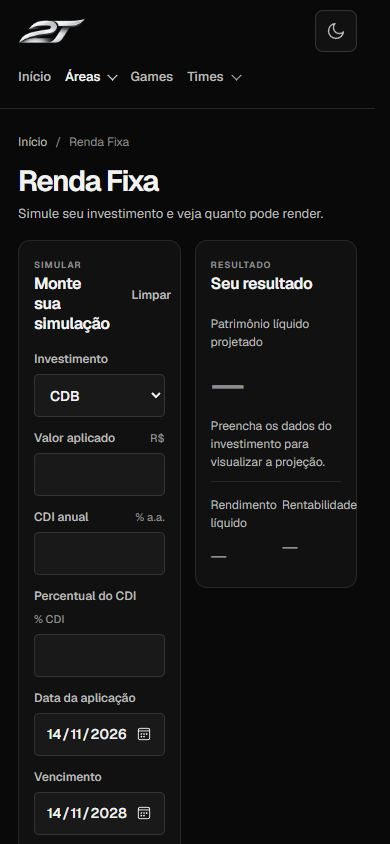
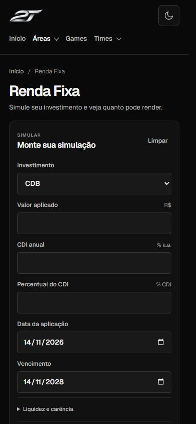

# 2T UX Redesign 2.1 — revisão visual e funcional

## Escopo e preservação

Revisão pontual das experiências existentes no branch `codex/2t-global-ux-redesign-2-1`, derivado da `main` em `ace36f9874d991e947e702165346633e7a24ddad`. Não houve mudança de stack, dependências, fórmulas financeiras, APIs, conteúdo pedagógico, persistência, lógica dos jogos ou protocolo WebRTC. O checkout principal foi preservado.

## Refinamentos entregues

| Área | Ajuste |
|---|---|
| Calculadoras | Busca agora considera nome, categoria e descrição; o placeholder informa os campos aceitos. |
| Renda Fixa | Ferramentas e comparação aparecem depois da simulação e antes dos detalhes; a ação foi nomeada “Ver resultado” para refletir o resultado calculado em tempo real; o estado vazio explica quais dados faltam. Em larguras até 900px, formulário e resultado empilham em largura total, com teste geométrico. A tabela mantém indicação de rolagem e primeira coluna identificável. |
| Times | O próximo jogo destacado não se repete na lista subsequente; contagem e estado vazio refletem somente os jogos restantes. |
| Calendário de Times | Dias com partidas expõem confrontos em `aria-description` e `title`; em celular há uma prévia curta do primeiro confronto. |
| Learn | Configuração do plano diário começa recolhida; feedback das respostas diferencia visualmente correto, incorreto e incerto. |
| 2T Call | Consulta de sala tem estado de carregamento perceptível; ajustes de qualidade de transmissão ficam em seção expansível e acessível por teclado. Voz, mídia e conexões não foram alteradas. |
| Games | Categorias quebram em múltiplas linhas em telas estreitas; cada jogo apresenta título e caminho de retorno “Início / Games / [jogo]”. |

## Resultado por módulo

| Módulo | Achado e decisão | Resultado verificado |
|---|---|---|
| Calculadoras | Busca do catálogo ignorava termos que só apareciam na descrição. Corrigida. Os formulários e saídas de juros compostos/simples, PRICE, SAC, aposentadoria, aluguel x compra, amortização e CLT mantiveram o fluxo já aprovado; não houve mudança matemática. | Regressões cobrem os oito fluxos e a busca por descrição. Captura visual direta nesta rodada inclui aposentadoria e catálogo; a mudança de simulação detalhada ficou concentrada em Renda Fixa. |
| Mercado de Ações | A estrutura do PR #158 foi preservada. Na captura inicial o widget ainda carregava; em uma sessão real posterior, o TradingView de PETR4 montou o gráfico após ~23s. | 18 regressões de CVM, widgets isolados e estabilidade passaram. No teste real: `scrollY` permaneceu em 400px em 240 amostras durante 24s, sem erro JS e sem overflow; o screenshot está em `evidence/after/market-petr4-real-widget.jpg`. |
| Renda Fixa | Formulário e resultado estavam lado a lado também em celular, comprimindo campos. A grade agora os empilha até 900px; comparação/ferramentas ficam depois da etapa de simulação e antes dos detalhes. | Capturas antes/depois em 390px e depois em 768px confirmam a leitura em largura total. Testes verificam a posição geométrica dos painéis, resultados e cálculos. |
| Learn | A configuração do plano abria ocupando a primeira tela; feedback não diferenciava visualmente os estados. | Configuração recolhida por padrão; resultado `correct`, `incorrect` ou `uncertain` tem tratamento visual próprio. Regressões de atividades e foco passaram. |
| Call | Controles avançados de transmissão competiam com os controles principais; a entrada da sala não destacava claramente a espera. | Configurações ficam em seção expansível e acessível por teclado; o estado de consulta tem indicador de carregamento. Regressões de câmera, tela, áudio, PiP e chamada passaram. |
| Times e calendários | Próximo jogo aparecia outra vez na lista; o calendário mobile mostrava apenas a contagem. | Lista exclui o jogo já destacado e exibe os confrontos restantes; datas expõem adversários também em leitor de tela e prévia mobile. Testes passam para fixtures isolados. |
| Games | Em telas estreitas as categorias podiam ultrapassar a área útil; as páginas individuais não indicavam o caminho de retorno de forma consistente no título da aba. | Categorias quebram em linhas; título e breadcrumb nomeiam cada um dos dez jogos. As dez páginas foram carregadas e as mecânicas mantidas; testes existentes exercitam Snake, Sudoku, 2048, TERMO e Memória. Capturas antes/depois cobrem os dez jogos em 1366px/390px e ambos os temas. |

As páginas de Ações, as outras oito calculadoras e os layouts individuais dos jogos não receberam reestruturação ampla: os fluxos aprovados permaneceram claros nos estados observados e não houve um defeito adicional reproduzível que justificasse reescrevê-los. A Renda Fixa, a agenda mobile e a repetição da partida foram os problemas estruturais/funcionais confirmados.

## Evidências visuais

- `evidence/before/` e `evidence/after/` contêm comparações nas larguras 1366px e 390px, temas escuro e claro, para as 21 rotas selecionadas.
- A matriz automatizada percorreu 21 rotas × 6 larguras (320, 390, 768, 1024, 1366 e 1920px) × 2 temas, total de 252 combinações. Os resultados resumidos e a matriz detalhada estão em `evidence/responsive-matrix.json`.
- As páginas com widgets ou calendários de provedores externos foram avaliadas quanto ao layout e erros JavaScript. A captura não certifica disponibilidade, atualização ou integridade dos dados externos.

### Comparação representativa — Renda Fixa, celular 390px, tema escuro

| Antes | Depois |
|---|---|
|  |  |

## Validação

- `npm run build`: aprovado; inclui `tsc --noEmit`, build JavaScript e compilação SCSS.
- Regressão Playwright direcionada: 83 casos; 78 aprovados, 5 ignorados, 0 falhas, executada contra o servidor do worktree em `http://127.0.0.1:8000` com Brave/Chromium. Incluiu Call, calculadoras, Renda Fixa, os dez jogos, Learn, calendário e páginas de Times.
- Matriz visual final: 252 combinações verificadas, zero overflow horizontal e zero erros JavaScript.
- Uma primeira execução não válida usou a prévia estática antiga em `127.0.0.1:8123` e encontrou bundle desatualizado/rotas API 501. Não foi usada como aprovação; a suíte foi repetida contra o servidor FastAPI correto.
- Regressão adicional de Ações: 18/18 passou. Os testes incluem layout sem TradingView, limpeza de widgets, CVM e eventos de rolagem nas larguras 320–1920px. Uma tentativa inicial foi bloqueada porque o servidor não estava ouvindo e o Playwright tentou iniciar um Chromium não instalado; a repetição usou o Brave existente e o servidor local ativo.
- `git diff --check`: aprovado antes do commit.

## Limites e pendências

- A matriz visual verifica renderização, overflow horizontal e erros de JavaScript; não substitui revisão humana de todo conteúdo nem valida APIs de terceiros.
- O conector Vercel mostra apenas o projeto `dashboard-esportivo` na equipe `matheus2ts-projects`; o projeto correto `matheus2t` não aparece, mesmo consultando a equipe proprietária. Por isso não houve PR merge, deploy ou alegação de validação em produção. É necessário conceder acesso do conector ao projeto `matheus2t` para concluir a etapa remota.
- A captura cobre as telas principais representativas e os dez jogos, sem testar todos os estados de cada ferramenta.
